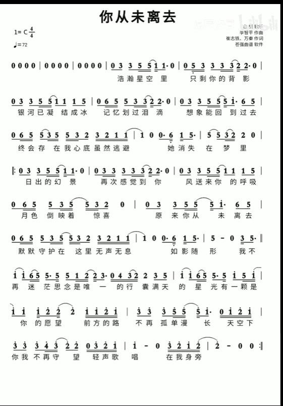

# Buzzer-Music
基于 STM32F10x 单片机实现的蜂鸣器音乐播放器，使用PWM 信号驱动有源蜂鸣器发声，搭配 OLED 屏幕显示当前播放曲目。
默认播放《你从未离去》，支持曲目切换，代码参考江科大 STM32 2023 入门教程编写。
原理说明：PWM 输出不同频率的方波，控制蜂鸣器振动频率，从而产生不同音高；音符持续时间控制节拍，实现简单乐曲播放。

## 硬件清单

- 主控：STM32F10x 系列单片机
- 发声模块：有源蜂鸣器（PWM 驱动）
- 显示模块：OLED 显示屏
- 配套：杜邦线、电源

## 功能特性

1. PWM 驱动有源蜂鸣器播放音乐
2. OLED 实时显示当前播放歌曲信息，音符和位置
3. 内置两首乐曲：
   - 默认曲目：《你从未离去》
   - 备选曲目：《小星星》
4. 代码结构参考江科大 STM32 入门教程，可读性强，便于二次修改乐谱

## 开发参考

> 教学视频：
> 【STM32入门教程-2023版 细致讲解 中文字幕】 https://www.bilibili.com/video/BV1th411z7sn/?p=16&share_source=copy_web&vd_source=595c609fadd7f2ab65b0c8df51439644

> 补充乐理参考：
> 如果每秒弹奏钢琴的C键440次，它会发A音还是C音？ - 知乎
https://www.zhihu.com/question/664475250

## 乐谱

